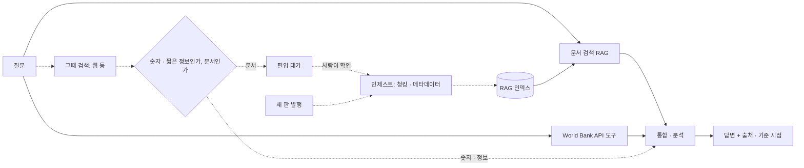

# 자료 지도 — 무엇이 어디에 머무나

이슈 #33의 답으로 쓰는 표입니다. 예시 세 줄은 지우고 본인 것으로 채우세요.

> 첫 답과 달라진 점: 「그때 검색」으로 얻은 문서 · 정보를 다룰 자리가 새로 생겼고(5번째 줄), 새 데이터가 인덱스로 돌아오는 길(편입 대기 → 사람 확인 → 인제스트)이 없다는 게 빠진 화살표임을 알게 됐다. (나머지 4줄의 자리는 첫 답과 같다)

## 1. 자료 지도

| 자료 종류 | 지금 어디에 있나 | 어디에 두는 게 맞나 (RAG / API 도구 / 그때 검색) | 얼마나 자주 바뀌나 | 평가 질문 몇 번에 쓰이나 | 문서 수 |
|---|---|---|---|---|---|
| 정책 · 법령 | RAG | RAG | 수개월~수년 | 3, 4, 5, 6, 8 | 5 |
| 광물 통계 · 전망 | RAG | RAG | 연 1회 | 1, 2, 7, 9 | 3 |
| 거시경제 보고서 | RAG | RAG | 분기~연 | 10 | 2 |
| 거시지표 수치 (World Bank) | API 도구 (답변에만 쓰고 버림, 캐시 없음) | API 도구 | 일~월 | 10 (도구 질문) | — |
| 웹 검색 등으로 얻은 문서 · 정보 | 없음 (웹 검색 Tool은 계획 중) | 그때 검색 | 부정기 | 7 | — |

- 「지금」과 「맞나」가 다른 줄이 고칠 곳입니다. → 5번째 줄 (지금 없음 → 그때 검색)
- 문서 수는 청크 수가 아니라 문서 단위로 셉니다.
- 「그때 검색」: 숫자 · 짧은 정보는 답변에만 쓰고(출처 · 기준 시점 표기), 문서는 편입 후보로 남겨 사람이 확인한 뒤 인제스트한다.

## 2. RAG 목적 카드

| 항목 | 내용 |
|---|---|
| 답하려는 질문 | 브라질 핵심 광물(리튬 중심)의 투자 기회를 볼 때 필요한 근거를 문서에서 찾는 질문. ① 사실 확인: 매장량 · 점유율(1, 2번) ② 정책 · 법령 · 기금(3~6번) ③ 여러 문서 종합: 밸류체인 · 법령 영향 · 광종 비교(7, 8, 9번) ④ 거시 환경: 문서 + World Bank 도구(10번) |
| 넣는 것 | 브라질 핵심 광물 투자 판단에 필요한 공식 · 공개 서술형 문서. 정책 · 법령 5건, 광물 통계 · 전망 3건, 거시경제 보고서 2건. 라이선스를 확인할 수 있는 것만 |
| 넣지 않는 것 | 바뀌는 숫자(→ API 도구) / 검증 안 된 문서 / 뉴스 · 블로그 같은 2차 자료 / 투자 판단 · 의견 글 / 원문 대조 없이 기계 번역만 한 문서 (※ 지금 9건은 대조 예정, PNM 2050만 완료) |
| 청크에 붙이는 정보 | 문서 ID · 언어 · 제목 · 발행처 · 발행일 · 원문 URL · 라이선스 · 원문 쪽 · 섹션 · 청크 번호. 본문 앞에 [문서]/[섹션]/[원문 쪽] 머리말. 청크 ID는 doc_id:lang:번호 |
| 갱신하는 때 | 같은 문서의 새 판이 발행됐을 때. 그 문서만 다시 인제스트 |

## 3. 새 데이터의 경로

실선은 지금 있는 길, 점선은 새로 만들 길입니다.

- 지금은 LLM이 질문을 보고 RAG와 World Bank 도구를 직접 고른다. 질문을 쪼개는 단계(7~9번용)는 구현 예정이다.
- 점선 전부가 지금 없는 길이다. 특히 「문서 → 편입 대기 → 사람 확인 → 인제스트」가 빠져 있던 화살표다.
- 수동 인제스트(`/admin/ingest`)는 지금도 있어서, 편입은 처음에는 수동으로 시작할 수 있다.

## 4. 아직 못 정한 것

- 웹 검색으로 얻은 문서를 자동으로 편입할지, 수동으로 할지
- 청크에 「숫자의 기준 연도」(발행일과 다름)를 메타데이터로 추가할지 (지금은 LLM이 본문에서 읽어 적음. 점수를 재고 나서 다시 보기)
- 쪽 표시가 없는 5건(Caderno 3, ANM, Lei, BNDES, CIMCE)의 쪽 표시 추가
- 기존 번역본 9건의 원문 대조
